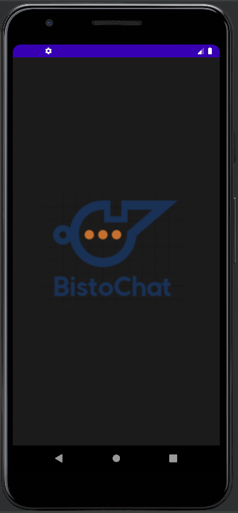
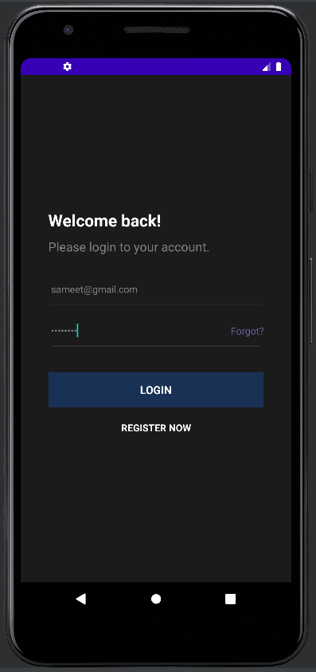
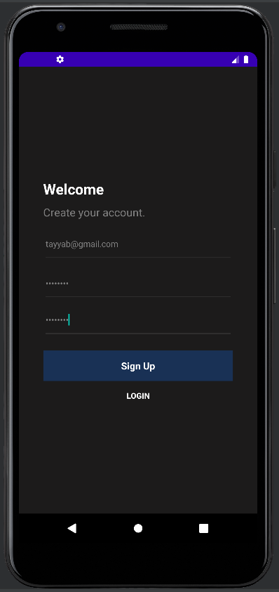
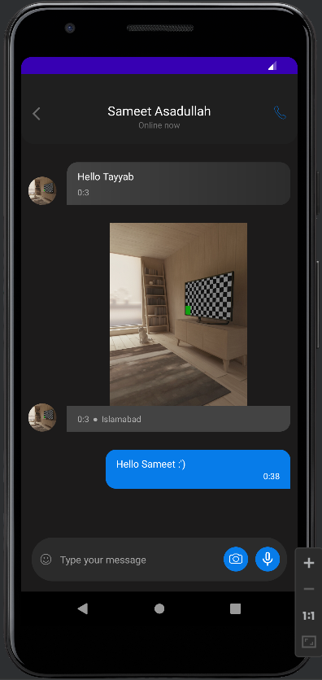

# Bisto Chat — Android and PHP

A full-stack messaging system with a Java Android client and a PHP/MySQL API. The application covers user profiles, contact discovery, text and image conversations, message editing/deletion, camera integration, and peer-to-peer calling.


## Features

- Registration, login, and profile creation.
- Contact and conversation lists.
- Text and image messaging.
- Message editing and deletion.
- Profile-picture and message-image uploads.
- Camera and screenshot-related interfaces.
- Audio/video calling experiment using bundled web assets and the Sinch Android SDK.

See [Architecture](docs/ARCHITECTURE.md) for the division between the Android app, PHP endpoints, MySQL schema, and calling experiment.

## Repository structure

```text
api/                       PHP API endpoints
database/schema.sql        Reproducible MySQL schema
mobile/                    Gradle Android project
mobile/app/src/main/assets/  Calling web assets
extras/                    Application and database screenshots
```

## Local setup

### Backend

1. Install PHP, MySQL, and a web server, or use XAMPP.
2. Import `database/schema.sql`.
3. Expose the files in `api` through the web server.
4. Configure the MySQL connection through environment variables:

   ```bash
   export BISTO_DB_HOST="localhost"
   export BISTO_DB_PORT="3306"
   export BISTO_DB_NAME="bisto_chat"
   export BISTO_DB_USER="bisto_app"
   export BISTO_DB_PASSWORD="your-password"
   ```

   `.env.example` lists the supported values. The PHP runtime must receive them from your shell, Apache, or PHP-FPM configuration.

### Android client

1. Open `mobile` in Android Studio.
2. Update `api_base_url` in `mobile/app/src/main/res/values/strings.xml` if the backend is not running on the Android emulator's host machine.
3. Sync Gradle and run the application on an emulator or device running API 21 or newer.

The default `10.0.2.2` address is the Android emulator alias for the development computer. A physical device needs the computer's reachable LAN address and both devices must be on the same network.

## Screenshots

| Splash | Login | Registration | Profile |
| --- | --- | --- | --- |
|  |  |  |  |

| Contacts | Conversation | Chat list | Edited message |
| --- | --- | --- | --- |
|  |  |  |  |

## Project status and security

This repository preserves the original 2021 Android/PHP implementation. It should not be exposed to the public internet without prepared SQL statements, password hashing, authenticated API tokens, HTTPS, authorization checks, upload validation, and dependency upgrades.

## Contributors

- [Sameet Asadullah](https://github.com/SameetAsadullah)
- [Tayyab Ali](https://github.com/DarkDragz)

## License

Licensed under the [MIT License](LICENSE).
